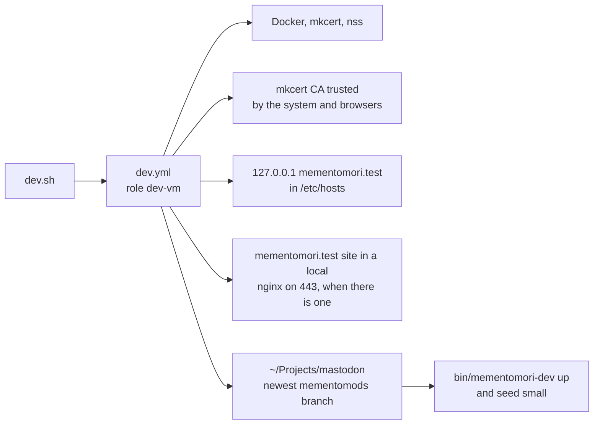

# Mementomori.social Mastodon instance playbooks

     [](https://github.com/mementomori-social/ansibles/actions/workflows/lint.yml) [](https://github.com/mementomori-social/ansibles/actions/workflows/dev.yml)

This repo contains ansible automation to setup and maintain
[mementomori.social Mastodon instance](https://mementomori.social) infra.

In addition to this repo you will need set of variables defined in
secrets/vault.yml file. All such variables are named with prefix `vault_` so
you know to create your own vault if you want to try this automation yourself.

> [!IMPORTANT]
> **Want the mementomori.test development environment on your Mac or Linux machine?** Run this, nothing else is needed:
>
> ```sh
> git clone https://github.com/mementomori-social/ansibles.git && ansibles/dev.sh
> ```
>
> It installs Docker, mkcert and Ansible if missing, trusts the local certificate, adds `mementomori.test` to `/etc/hosts`, clones [our Mastodon fork](https://github.com/mementomori-social/mastodon) to `~/Projects/mastodon` and starts it with demo data. See [Development environment](#development-environment). To then build a feature, for mementomori.social or as a pull request to Mastodon itself, follow [Developing a feature](https://github.com/mementomori-social/mastodon/blob/mementomods-2026-10-11/dev/README.md#developing-a-feature) in the fork. The rest of this repo is for the production servers.

## Prerequisites

1. [Install ansible](https://docs.ansible.com/projects/ansible/latest/getting_started/get_started_ansible.html).
2. Clone this repo and goto that directory
   `git clone https://github.com/mementomori-social/ansibles.git` 
3. Pull required collections
   `ansible-galaxy collection install -r collections/requirements.yml -p collections`
4. Clone secret vault and link to it
   ```sh
   git clone <vault_url> ../secrets
   ln -s ../secrets
   ```
5. Write your vault password to .vaultpw file
6. If you want messages sent to matrix install matrix-client
   `pip install matrix-client`

## Inventories

* `inventory-upcloud.yml` is the dynamic inventory for UpCloud, see
  [the docs](https://upcloud.com/docs/guides/get-started-ansible-inventory/).
  Hosts are grouped by their `role` label, and every host except the bastion
  is reached through the bastion.

Check the inventory contents:

```sh
PYTHONPATH=collections ansible-inventory -i inventory-upcloud.yml --graph --vars
```

## Secrets Vault

We have secrets in ansible vault. It's a good idea to put link to vault in `group_vars/all/` directory.

```sh
cd group_vars/all
ln -s ../../secrets/vault.yml .
```

## Build a server

Servers live in UpCloud zone `fi-hel2` on the private network `10.222.222.0/24`.

1. Create the private network, router and NAT gateway, once per zone:
   ```sh
   ansible-playbook upcloud-network.yml
   ```
2. Create the data disks the server needs, then put each UUID in its
   `upcloud-create-*.yml` (`data_storage_uuid`, `backup_storage_uuid`).
   Data disks live apart from the server, so rebuilding a server keeps its data:
   ```sh
   upctl storage create --zone fi-hel2 --tier maxiops --size 300 --title postgresql.mementomori.social-data
   ```
3. Create the server. Build the bastion first, the other servers are reached
   through it:
   ```sh
   ansible-playbook upcloud-create-bastion.yml
   ansible-playbook upcloud-create-postgresql.yml
   ansible-playbook upcloud-create-elastic.yml
   ansible-playbook upcloud-create-mastodon-0.yml
   ```
4. Configure it, or every server at once with `site.yml`:
   ```sh
   ansible-playbook -i inventory-upcloud.yml postgresql.mementomori.social.yml
   ```

## Playbooks

### Quick health check of the machines

Checks the hosts are reachable and, with `-e send_to=matrix`, posts a summary
to the Matrix channel.

```sh
ansible-playbook -i inventory-upcloud.yml ping.yml
```

### Update hosts

Updates the software packages and restarts a host when the update needs it.

```sh
ansible-playbook -i inventory-upcloud.yml update-host.yml
```


## Roles

We provision services based on roles. Aim is so we can scale and move services
between the hosts if later needed.

* **dev-vm** - Set up the mementomori.test dev environment on a developer's own machine
* **elasticsearch** - Install and configure elastic search for mastodon search
* **mastodon** - Install and configure mastodon services
* **nginx** - Install and configre web server with reverse proxy and cert automation
* **postgresql** - Install and configure database for mastodon
* **valkey** - Install and configure key-val store for mastodon

## Development environment

`dev.sh` runs `dev.yml` with the `dev-vm` role against your own machine. It works on macOS, Arch Linux, Debian and Ubuntu, and asks for your sudo password once for the system changes, unless sudo needs none. The stack itself is Docker from the Mastodon fork, described in `dev/README.md` there, including [how to develop a feature](https://github.com/mementomori-social/mastodon/blob/mementomods-2026-10-11/dev/README.md#developing-a-feature) for mementomori.social or for Mastodon.



| Step | macOS | Arch | Debian, Ubuntu |
| --- | --- | --- | --- |
| Docker | Docker Desktop with Homebrew, skipped when Docker Compose 2.24 or newer is already there | `docker`, `docker-buildx`, `docker-compose`, and you in the `docker` group | Docker's apt repository, and you in the `docker` group |
| Certificate | System keychain, macOS asks to confirm | System trust store | System trust store |

Two things need you at the keyboard on macOS: Docker Desktop's licence on its first start, and the keychain confirmation. On Linux log out and in once afterwards so the `docker` group applies to your own shell.

Running it again is safe. An existing checkout is never switched or pulled, and an already seeded database is left alone.

The site is always https://mementomori.test when port 443 is free or held by a local nginx, such as a LEMP setup for other `.test` sites. With nginx on 443 the stack listens on 8443 and the playbook adds a `mementomori.test` site to nginx that forwards to it, then reloads nginx. Any earlier `mementomori.test` site, for example a hand-built one, is moved to `~/.local/share/mementomori-dev/nginx-backup/` first. If that file also serves other sites, the playbook stops instead. When something other than nginx holds 443, the address is https://mementomori.test:8443. The playbook prints the address and remembers the ports for `bin/mementomori-dev`.

Demo posts store the full address, so when it changes (for example from `:8443` to the plain address) the playbook wipes and reseeds the demo data. Log in as `demo@mementomori.test`, `admin@mementomori.test` or `moderator@mementomori.test`, password `mementomori`.

The playbook ends by loading the site over HTTPS with certificate checking on, so a certificate the system doesn't trust fails the run. On Linux it also creates Chrome's certificate store (`~/.pki/nssdb`) when missing, since mkcert only adds its CA to stores that exist.

CI (`.github/workflows/dev.yml`) runs `dev.sh` twice on clean machines, once with port 443 free and once behind an nginx that already has other sites. The second run must change nothing. Ubuntu runs the whole stack and the fork's `bin/mementomori-dev check`; macOS 26 runs everything except Docker, which GitHub's macOS runners can't run, with a stand-in HTTPS server instead. Ubuntu also opens the site in headless Chrome (`tests/dev-browser-check.sh`) and fails on a certificate warning. On the macOS runners headless Chrome hangs even for a plain page, so there that step may fail without failing the job; curl still checks the certificate. The repository variable `DEV_FORK_BRANCH` picks the fork branch to test; without it CI uses the newest `mementomods-*` branch.

Settings, given with `-e`, for example `./dev.sh -e dev_vm_seed_scale=default`:

| Variable | Default | |
| --- | --- | --- |
| `dev_vm_checkout` | `~/Projects/mastodon` | Where the fork is cloned |
| `dev_vm_repo` | the fork over HTTPS | Use `git@github.com:mementomori-social/mastodon.git` to push over SSH |
| `dev_vm_branch` | newest `mementomods-*` | Branch for a new clone |
| `dev_vm_https_port` | 443, or 8443 behind nginx or when taken | Fixed port, turns off the nginx forwarding |
| `dev_vm_nginx_proxy` | `true` | `false` keeps nginx untouched and uses `:8443` |
| `dev_vm_reset_on_address_change` | `true` | `false` keeps demo data when the address changes |
| `dev_vm_stack` | `true` | `false` skips Docker on macOS and starting the stack, for CI |
| `dev_vm_seed_scale` | `small` | `small`, `default`, `large`, or empty to skip |

## Testing

[Molecule](https://docs.ansible.com/projects/molecule/) can be used to test the playbooks created.
It is set to use podman with Ubuntu 26.04 images, the same as the UpCloud template, for testing the playbooks.
See test [inventory.yml](molecule/default/inventory.yml) for test containers
and [verify.yml](molecule/default/verify.yml) for test cases.

Useful commands (in repo root):

```sh
# Test the complete lifecycle
molecule test

# Run specific actions
molecule create
molecule converge
molecule verify
```

This lets you keep running ansible setup playbooks and tests all over again
without always destroying the containers in between.

## Requirements

You'll need podman and molecule on your dev env. In Fedora:

```sh
sudo dnf install podman
pip install --user molecule
```

